# WoundApp Docs

**[English](#english)** · **[Italiano](#italiano)**

A concept of how a wound documentation app should be: photos, measurements, dressings and scale scores over time, all on the phone. · Un concept di come dovrebbe essere un'app per documentare le lesioni: foto, misure, medicazioni e punteggi delle scale nel tempo, tutto sul telefono.

Version 1.6.9-docs · Android 11 or later · not on Google Play: test builds are shared by hand.

<p align="center">
  <a href="https://github.com/Daveide90/woundapp-docs/releases/latest/download/WoundAppDocs.apk"></a>
</p>
<p align="center"><sub><a href="https://github.com/Daveide90/woundapp-docs/releases">All versions, notes and SHA-256 · Tutte le versioni, note e SHA-256</a></sub></p>

> [!WARNING]
> **This app is NOT a medical device.** WoundApp Docs is a concept: a working prototype of how a wound documentation app should be, made by a hobbyist. It is not a finished or certified product. It does not diagnose, gives no treatment advice and no clinical decision support. **The author takes no responsibility for how the app is used** or for the consequences of its use, to the extent permitted by law. Whoever uses it does so on their own responsibility.
>
> **Quest'app NON è un dispositivo medico.** WoundApp Docs è un concept: un prototipo funzionante di come dovrebbe essere un'app per documentare le lesioni, fatto da un appassionato. Non è un prodotto finito né certificato. Non fa diagnosi, non dà indicazioni di trattamento né supporto alle decisioni cliniche. **L'autore non si assume alcuna responsabilità per il modo in cui l'app viene usata** né per le conseguenze del suo uso, nei limiti consentiti dalla legge. Chi la usa lo fa sotto la propria responsabilità.

<table>
<tr><td align="center" width="25%">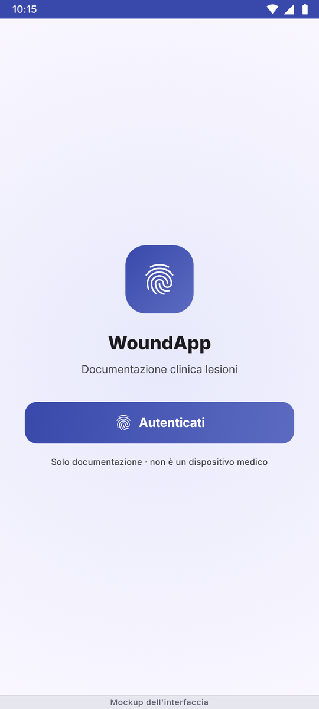</td><td align="center" width="25%">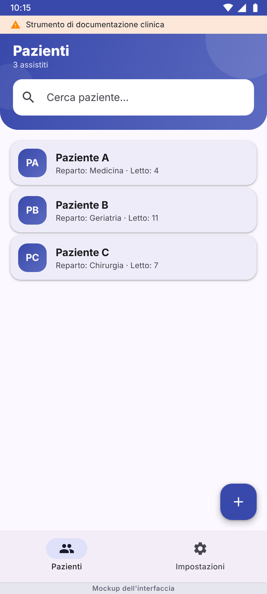</td><td align="center" width="25%">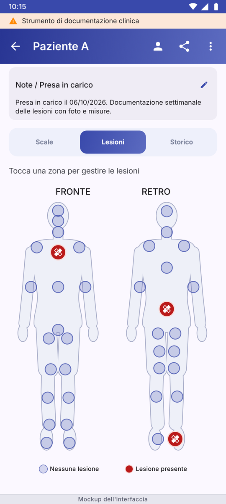</td><td align="center" width="25%">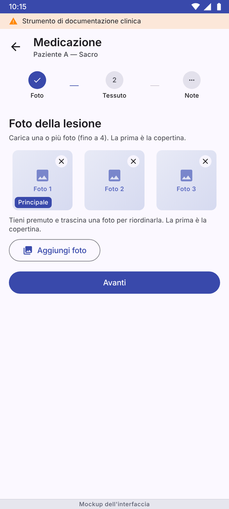</td></tr>
<tr><td align="center"><b>Login</b> · Accesso</td><td align="center"><b>Patients</b> · Pazienti</td><td align="center"><b>Body map</b> · Mappa corporea</td><td align="center"><b>Photos</b> · Foto</td></tr>
<tr><td align="center" width="25%">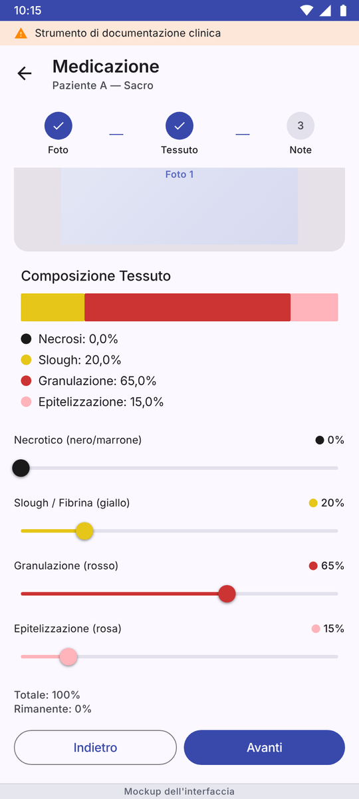</td><td align="center" width="25%">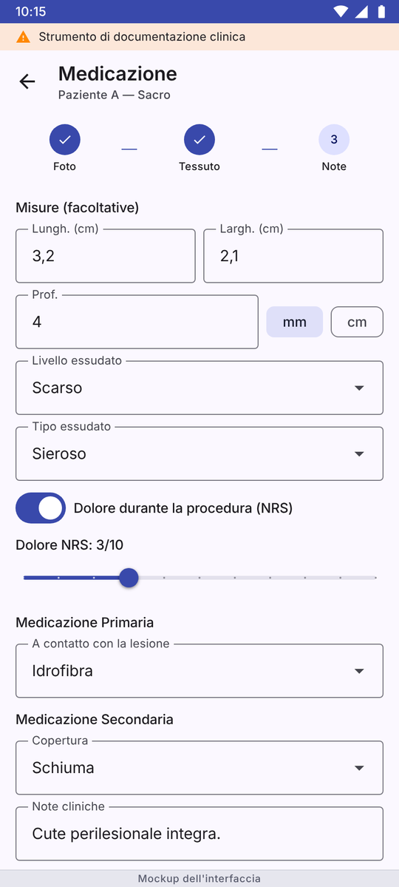</td><td align="center" width="25%">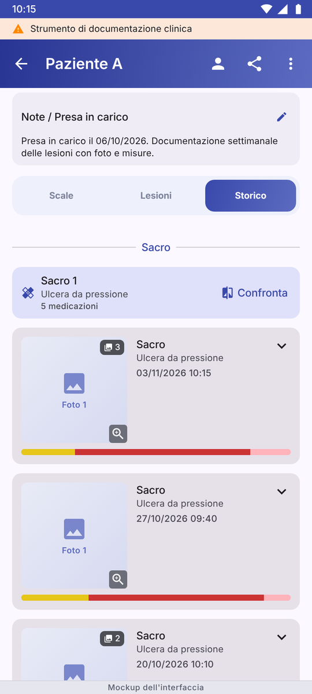</td><td align="center" width="25%">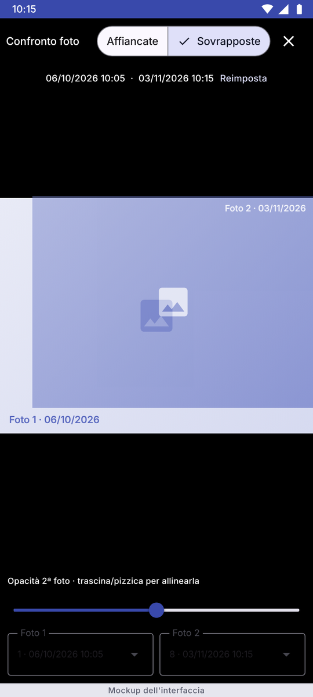</td></tr>
<tr><td align="center"><b>Tissue</b> · Tessuti</td><td align="center"><b>Measures</b> · Misure</td><td align="center"><b>History</b> · Storico</td><td align="center"><b>Compare</b> · Confronto</td></tr>
<tr><td align="center" width="25%">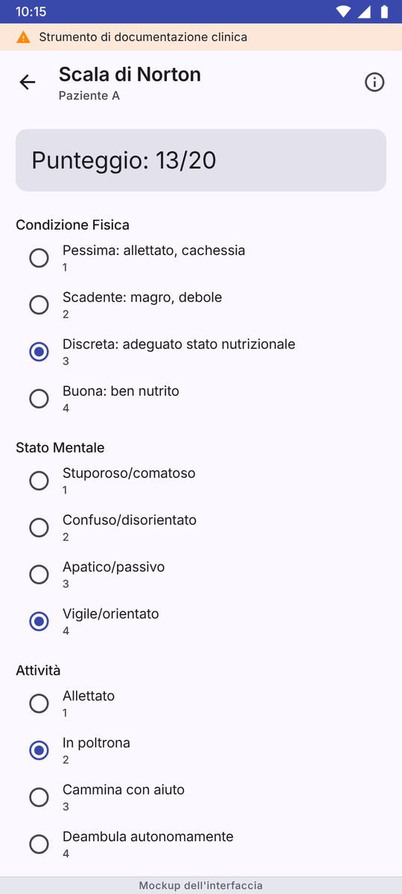</td><td align="center" width="25%">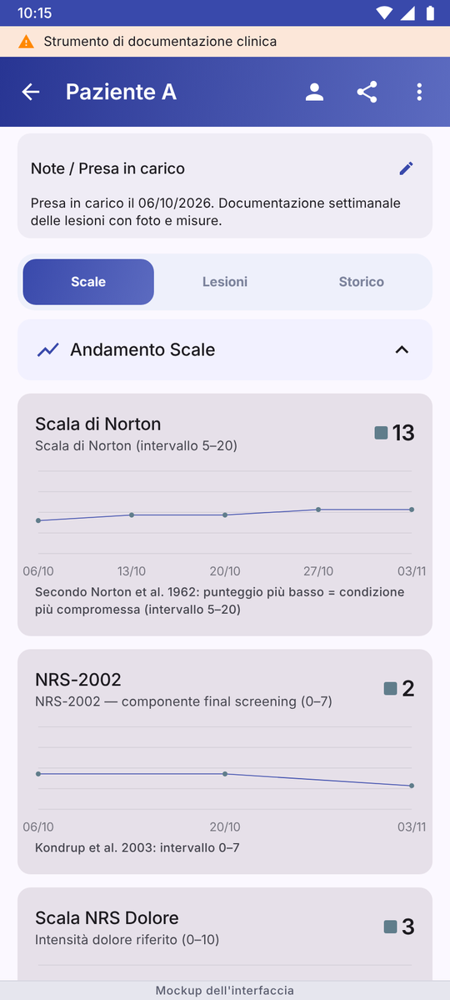</td><td align="center" width="25%">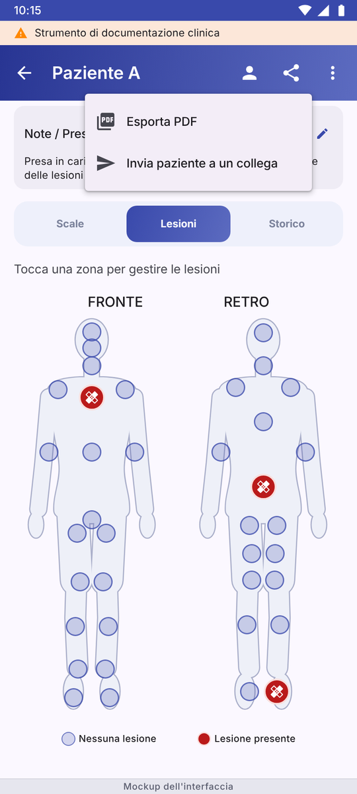</td><td align="center" width="25%">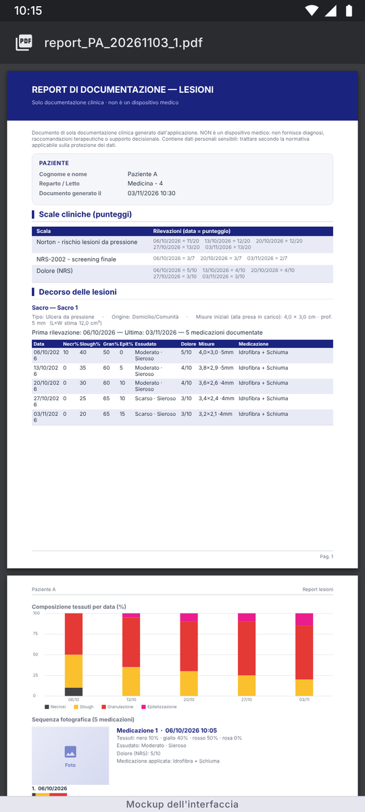</td></tr>
<tr><td align="center"><b>Norton scale</b> · Scala di Norton</td><td align="center"><b>Scores</b> · Punteggi</td><td align="center"><b>Export</b> · Esporta</td><td align="center"><b>PDF report</b> · Report PDF</td></tr>
<tr><td align="center" width="25%">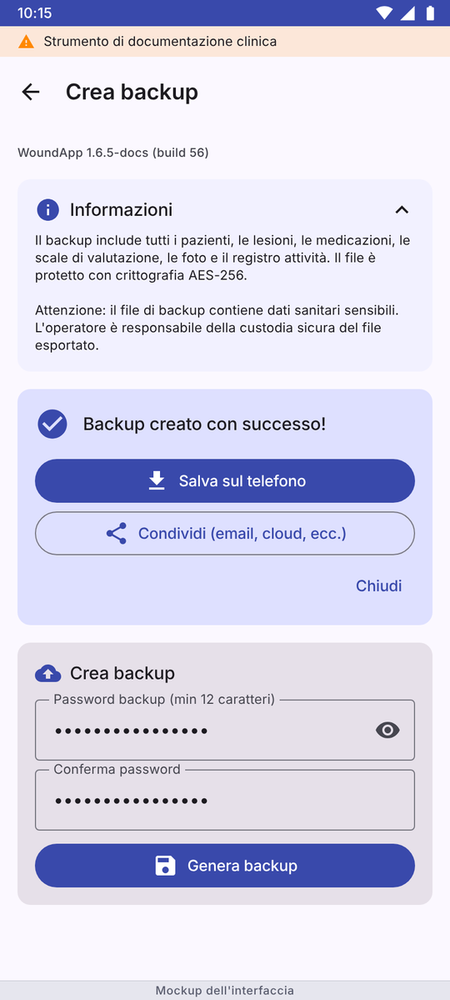</td><td align="center" width="25%">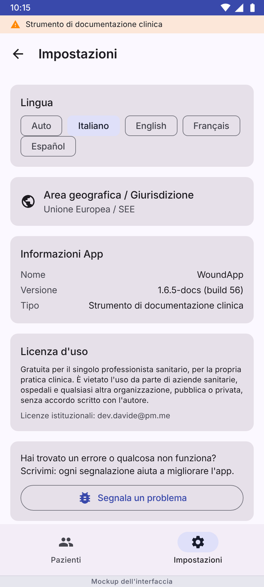</td><td align="center" width="25%">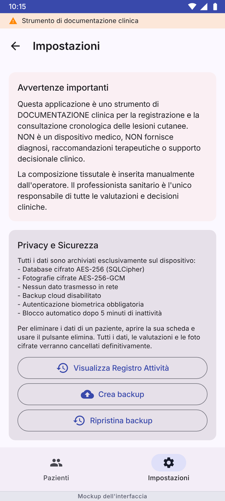</td><td align="center" width="25%">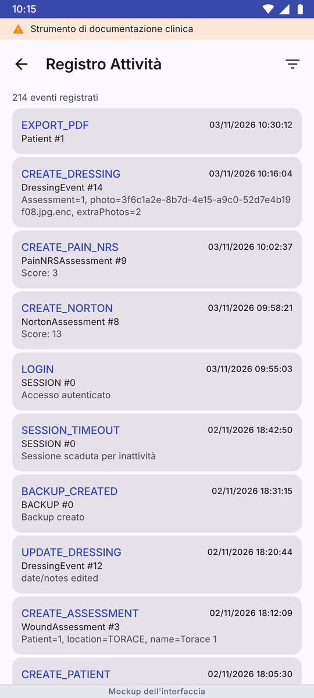</td></tr>
<tr><td align="center"><b>Backup</b> · Backup</td><td align="center"><b>Settings</b> · Impostazioni</td><td align="center"><b>Privacy</b> · Privacy</td><td align="center"><b>Audit log</b> · Registro</td></tr>
</table>

<sub><b>These images are an HTML mockup of the interface, not screenshots</b>: the real app blocks screen capture to protect patient data. Made from the app's code and texts with invented data (`docs/mockup/mockup.html`); details may differ slightly. · <b>Queste immagini sono un mockup HTML dell'interfaccia, non catture dello schermo</b>: l'app vera impedisce le catture per proteggere i dati dei pazienti. Ricostruite dal codice e dai testi dell'app con dati inventati; i dettagli possono differire un poco.</sub>

---

## English

WoundApp Docs is a concept of how an app should help a nurse or a clinician document skin lesions: who the patient is, where the wound is, what it looks like at each dressing, what was used and how the scale scores change. It records what the professional enters and shows it back in order. It does not analyse images, does not interpret scores and does not suggest treatments. No data leave the phone: the app has no Internet permission.

### What it does

| Feature | How it works |
|---|---|
| **Patients** | Encrypted patient archive with notes and search. |
| **Body map** | 38 zones, front and back (perineum and face included); each wound is pinned to its zone, with type and origin. |
| **Dressings** | Up to 4 photos per dressing from the system gallery, reordered by dragging (the first is the cover). Tissue composition entered by hand with four sliders (necrotic, slough, granulation, epithelial). Length, width and depth in mm or cm, exudate, primary and secondary dressing, optional procedural pain, notes. The date can be corrected, never set in the future. |
| **History and comparison** | Timeline of every wound with photos and measurements. Two photos of the same wound can be viewed side by side or overlaid with adjustable opacity, and aligned with the finger. Display only: nothing is highlighted or computed. |
| **Scales** | Norton, NRS-2002 (final screening component only) and NRS pain, with item descriptions paraphrased from the published sources. Raw score only: no cut-offs, no risk bands, no interpretation. The score history is a neutral chart. |
| **PDF report** | Documentation report per patient: chronological table, stacked bar chart of tissue percentages by date, numbered and dated photos. Useful also for GDPR access and portability requests. |
| **Backup and transfer** | Encrypted backup of everything or of a single patient, to hand a patient over to a colleague. Import merges without duplicates: a patient already present is recognised and only new wounds, dressings, photos and scores are added. |
| **Audit log** | Local log of the main operations on patients, wounds, dressings and exports. |
| **Languages** | Italian, English, French, Spanish. In French and Spanish the clinical text of the scales stays in English. |

### Concept, intended use and responsibility

WoundApp Docs is a concept: it shows, with software that works, how a wound documentation app for healthcare professionals should be. It is not a finished or certified product. **It is not a medical device** under Regulation (EU) 2017/745: it does not diagnose, treat, prevent or monitor any condition, and it does not give clinical advice. Scores are plain sums of the items entered; tissue percentages are typed in by the professional. Clinical decisions, and the responsibility for them, stay with the professional. **The author takes no responsibility for how the app is used**, for the data entered or for any consequence of its use, to the extent permitted by law: the app is offered free of charge, as is, without any warranty (see the [LICENSE](LICENSE)). The intended-use analysis is being updated to the current version and will be published when it is ready.

**Who may use it.** The app suits a self-employed professional, who is the data controller. A nurse or doctor employed by a hospital or care home documents patients of that organisation, which is the data controller: using the app on a personal phone needs the organisation's authorisation and must follow its rules.

Android 11 or later is required: from 1.6.9 the app no longer installs on Android 8, 9 and 10, where it closed at start.

The images on this page are an HTML mockup of the interface, not screenshots: the app blocks screen capture, to protect patient data.

### Privacy and security

| Aspect | How it is done |
|---|---|
| Network | No Internet permission: the app contacts no server and sends no analytics, cookies or trackers. |
| Who controls the data | The developer receives no data and is not a data processor. The professional, or the healthcare organisation, is the data controller under the GDPR. |
| Database | SQLCipher (AES-256), random 256-bit key protected by the Android Keystore; opened only after login. |
| Photos | Encrypted on import (AES-256-GCM), random file names. No in-app camera and no photo permission: the system picker hands over only the chosen photos. |
| Access | Fingerprint or phone credential at start; session ends after 5 minutes of inactivity; warning on rooted phones. |
| Backup | PBKDF2-HMAC-SHA256 with 600,000 iterations and AES-256-GCM; password of at least 12 characters. Android backup and device transfer are off. |
| Screen | Screenshots, screen recording and the recent-apps preview are always blocked. |
| Permissions | Biometrics only. |

Details in [SECURITY.md](SECURITY.md) and [PRIVACY_POLICY.md](PRIVACY_POLICY.md).

### How I approached security

**Secure by design.** Patient data never leave the phone: no Internet permission, no server, no account, no analytics. The database is encrypted with SQLCipher and opened only after the fingerprint or phone credential; photos are encrypted one by one; backups are encrypted with a password; screenshots, Android cloud backup and device transfer are blocked.

**Hardened as far as I could.** Database key protected by the Android Keystore, session closed after 5 minutes of inactivity, backups with AES-256-GCM and PBKDF2 raised to 600,000 iterations, size and format checks on imported backups, release builds without logs, minimal permissions (biometrics only), a warning on rooted phones, export file names without patient names and every export recorded in the audit log. On 3 November 2026 the database library was moved to the maintained SQLCipher for Android 4.17.0 (SQLite 3.53.3), closing ten known SQLite CVEs of the old one.

**Tested with automated attacks by AI, in several rounds.** From May to November 2026 groups of AI agents reviewed the app as an attacker would, in several cycles, and a second group re-checked the first group's findings from scratch: reading data without the key, getting past the login, forged or oversized backups, data left in memory or in temporary files. Confirmed weaknesses were fixed; encryption, backup and input checks are covered by automated tests.

**Limits.** Not an independent professional audit or a certification. A known open point: the database key is not yet cryptographically bound to the fingerprint (the lock is enforced by the app); it is listed in [SECURITY.md](SECURITY.md), where weaknesses can be reported privately.

### Install

Tap **Download APK** at the top of this page on an Android phone (Android 11 or later), open the file and, when Android asks, allow installation from your browser or file manager. The app is not on Google Play yet. The SHA-256 fingerprint of each APK is in the release notes, to check that the file is the original. If you have a test build older than 1.6.4, make an encrypted backup, uninstall it and then install this one: the signature changed with 1.6.4. From 1.6.4 on, updates install over the previous version.

### About the author

I am not a professional software developer: I am an enthusiast and I build apps in my spare time. WoundApp Docs was written with the help of AI tools (Claude, by Anthropic), and I played an active role in its architecture, features, project direction, design and technical review. It was checked with automated tests and on real phones, as carefully as I can. The app itself contains no artificial intelligence: no image analysis, no models, no automatic inference, so the AI Act (Regulation (EU) 2024/1689) does not apply to it. It is offered free of charge, as is, without warranty (see the [LICENSE](LICENSE)). If you find a problem, please report it.

### Build

```bash
./gradlew assembleDebug
```

Android Studio with JDK 17. Kotlin, Jetpack Compose, Material 3, Room with SQLCipher. The release signature reads `keystore.properties`, which is not in the repository.

### Licence

Proprietary licence ([LICENSE](LICENSE)): free for the individual healthcare professional (natural person) on their own devices; use by organisations requires a written agreement. All rights reserved. The app uses third-party open source components that keep their own licences: Android Jetpack (AndroidX, Compose, Room), Kotlin and kotlinx.coroutines, Gson, Tink, Guava ListenableFuture, JSpecify and JetBrains annotations under the Apache License 2.0, and SQLCipher for Android under Zetetic's BSD-style licence; Tink contains a copy of Protocol Buffers (BSD 3-Clause). Authors, licence texts and NOTICE files are in the app (Settings › Third-party licenses) and in [app/src/main/assets/licenze/licenze_di_terzi.txt](app/src/main/assets/licenze/licenze_di_terzi.txt). The changes from version to version are in the [CHANGELOG](CHANGELOG.md).

### Feedback

Problems and ideas: open an issue on this repository. Security problems: see [SECURITY.md](SECURITY.md).

---

## Italiano

WoundApp Docs è un concept di come un'app dovrebbe aiutare l'infermiere o il medico a documentare le lesioni cutanee: chi è il paziente, dove sta la lesione, com'è a ogni medicazione, che cosa si è usato e come cambiano i punteggi delle scale. Registra quello che il professionista inserisce e lo ripresenta in ordine. Non analizza le immagini, non interpreta i punteggi e non suggerisce trattamenti. Nessun dato esce dal telefono: l'app non ha il permesso Internet.

### Cosa fa

| Funzione | Come funziona |
|---|---|
| **Pazienti** | Archivio cifrato dei pazienti, con note e ricerca. |
| **Mappa corporea** | 38 zone, davanti e dietro (perineo e viso compresi); ogni lesione è agganciata alla sua zona, con tipo e origine. |
| **Medicazioni** | Fino a 4 foto per medicazione dalla galleria di sistema, riordinabili trascinandole (la prima è la copertina). Composizione tissutale inserita a mano con quattro cursori (necrotico, slough, granulazione, epitelio). Lunghezza, larghezza e profondità in mm o cm, essudato, medicazione primaria e secondaria, dolore procedurale facoltativo, note. La data si può correggere, mai nel futuro. |
| **Storico e confronto** | Cronologia di ogni lesione con foto e misure. Due foto della stessa lesione si guardano affiancate o sovrapposte con opacità regolabile, e si allineano col dito. Solo visualizzazione: niente viene evidenziato o calcolato. |
| **Scale** | Norton, NRS-2002 (solo la parte «final screening») e NRS del dolore, con le descrizioni degli item parafrasate dalle fonti pubblicate. Solo il punteggio grezzo: nessun cut-off, nessuna fascia di rischio, nessuna interpretazione. Lo storico dei punteggi è un grafico neutro. |
| **Report PDF** | Report di documentazione per paziente: tabella cronologica, grafico a barre delle percentuali dei tessuti per data, foto numerate e datate. Utile anche per le richieste di accesso e portabilità del GDPR. |
| **Backup e trasferimento** | Backup cifrato di tutto o di un solo paziente, per passarlo a un collega. L'importazione unisce senza doppioni: il paziente già presente viene riconosciuto e si aggiungono solo lesioni, medicazioni, foto e punteggi nuovi. |
| **Registro attività** | Registro sul telefono delle operazioni principali su pazienti, lesioni, medicazioni ed esportazioni. |
| **Lingue** | Italiano, inglese, francese, spagnolo. In francese e spagnolo il testo clinico delle scale resta in inglese. |

### Concept, uso previsto e responsabilità

WoundApp Docs è un concept: mostra, con un software che funziona, come dovrebbe essere un'app di documentazione delle lesioni per professionisti sanitari. Non è un prodotto finito né certificato. **Non è un dispositivo medico** ai sensi del regolamento (UE) 2017/745: non fa diagnosi, non tratta, non previene né monitora malattie e non dà consigli clinici. I punteggi sono semplici somme degli item inseriti; le percentuali dei tessuti le scrive il professionista. Le decisioni cliniche, e la loro responsabilità, restano al professionista. **L'autore non si assume alcuna responsabilità per il modo in cui l'app viene usata**, per i dati inseriti né per le conseguenze del suo uso, nei limiti consentiti dalla legge: l'app è offerta gratis, così com'è, senza garanzie di alcun tipo (vedi la [LICENSE](LICENSE)). L'analisi della destinazione d'uso è in aggiornamento alla versione attuale e sarà pubblicata quando sarà pronta.

**Chi può usarla.** L'app è adatta al libero professionista, che è titolare dei dati. L'infermiere o il medico dipendente di un ospedale o di una struttura documenta pazienti della struttura, che è la titolare: usare l'app sul telefono personale richiede l'autorizzazione della struttura e il rispetto delle sue regole.

Serve Android 11 o successivo: dalla 1.6.9 l'app non si installa più su Android 8, 9 e 10, dove si chiudeva all'avvio.

Le immagini di questa pagina sono un mockup HTML dell'interfaccia, non catture dello schermo: l'app impedisce di catturare lo schermo, per proteggere i dati dei pazienti.

### Privacy e sicurezza

| Aspetto | Com'è fatto |
|---|---|
| Rete | Nessun permesso Internet: l'app non contatta server e non manda statistiche, cookie o tracker. |
| Chi controlla i dati | Lo sviluppatore non riceve dati e non è responsabile del trattamento. Il professionista, o la struttura, è titolare del trattamento ai sensi del GDPR. |
| Database | SQLCipher (AES-256), chiave casuale a 256 bit protetta dal Keystore di Android; si apre solo dopo l'accesso. |
| Foto | Cifrate all'importazione (AES-256-GCM), nomi dei file casuali. Nessuna fotocamera nell'app e nessun permesso sulle foto: il selettore di sistema consegna solo le foto scelte. |
| Accesso | Impronta o credenziale del telefono all'avvio; la sessione si chiude dopo 5 minuti di inattività; avviso sui telefoni con root. |
| Backup | PBKDF2-HMAC-SHA256 a 600.000 iterazioni e AES-256-GCM; password di almeno 12 caratteri. Backup di Android e trasferimento fra telefoni spenti. |
| Schermo | Screenshot, registrazione dello schermo e anteprima fra le app recenti sempre bloccati. |
| Permessi | Solo la biometria. |

Dettagli in [SECURITY.md](SECURITY.md) e [PRIVACY_POLICY.md](PRIVACY_POLICY.md).

### Come ho affrontato la sicurezza

**Sicura fin dal progetto.** I dati dei pazienti non escono mai dal telefono: nessun permesso Internet, nessun server, nessun account, nessuna statistica. Il database è cifrato con SQLCipher e si apre solo dopo l'impronta o la credenziale del telefono; le foto sono cifrate una per una; i backup sono cifrati con una password; screenshot, backup di Android e trasferimento fra telefoni sono bloccati.

**Rinforzata finché ho potuto.** Chiave del database protetta dal Keystore di Android, sessione chiusa dopo 5 minuti di inattività, backup con AES-256-GCM e PBKDF2 portato a 600.000 iterazioni, controlli di misura e formato sui backup importati, build di rilascio senza log, permessi al minimo (solo la biometria), avviso sui telefoni con root, nomi dei file esportati senza il nome del paziente e ogni esportazione scritta nel registro attività. Il 3 novembre 2026 la libreria del database è passata a SQLCipher per Android 4.17.0 (SQLite 3.53.3), mantenuta, che chiude dieci CVE note di SQLite della vecchia.

**Messa alla prova con attacchi automatici di un'IA, in più cicli.** Da maggio a novembre 2026 gruppi di agenti di intelligenza artificiale hanno esaminato l'app come farebbe un attaccante, in più giri, e un secondo gruppo ha ricontrollato da zero i rilievi del primo: leggere i dati senza la chiave, superare l'accesso, backup falsificati o enormi, dati rimasti in memoria o nei file temporanei. Le debolezze confermate sono state corrette; cifratura, backup e controlli sui dati inseriti sono coperti da prove automatiche.

**Limiti.** Non è una revisione professionale indipendente né una certificazione. Un punto aperto noto: la chiave del database non è ancora legata crittograficamente all'impronta (il blocco lo applica l'app); è scritto in [SECURITY.md](SECURITY.md), dove si possono segnalare le debolezze in privato.

### Installare

Tocca **Download APK** in cima a questa pagina da un telefono Android (Android 11 o successivo), apri il file e, quando Android lo chiede, consenti l'installazione dal browser o dal gestore dei file. L'app non è ancora su Google Play. L'impronta SHA-256 di ogni APK è nelle note della release, per controllare che il file sia l'originale. Se hai una versione di prova precedente alla 1.6.4, fai un backup cifrato, disinstallala e poi installa questa: la firma è cambiata con la 1.6.4. Dalla 1.6.4 in poi gli aggiornamenti si installano sopra la versione precedente.

### Chi la sviluppa

Non sono un programmatore professionista ma un appassionato, che sviluppa app nel tempo libero. WoundApp Docs è stata scritta con l'aiuto di strumenti di intelligenza artificiale (Claude, di Anthropic), e io ho svolto un ruolo attivo nell'architettura, nelle funzionalità, nella direzione del progetto, nel design e nel controllo tecnico. È stata controllata con prove automatiche e su telefoni veri, con tutta la cura che posso. Dentro l'app l'intelligenza artificiale non c'è: nessuna analisi delle immagini, nessun modello, nessuna inferenza automatica, quindi l'AI Act (regolamento (UE) 2024/1689) non si applica. È offerta gratis, così com'è, senza garanzie (vedi la [LICENSE](LICENSE)). Se trovi un problema, segnalalo.

### Compilare

```bash
./gradlew assembleDebug
```

Android Studio con JDK 17. Kotlin, Jetpack Compose, Material 3, Room con SQLCipher. La firma di rilascio legge `keystore.properties`, che non sta nel repository.

### Licenza

Licenza proprietaria ([LICENSE](LICENSE)): gratuita per il singolo professionista sanitario (persona fisica) sui propri dispositivi; l'uso da parte di strutture e organizzazioni richiede un accordo scritto. Tutti i diritti riservati. L'app usa componenti open source di terzi che restano sotto le loro licenze: Android Jetpack (AndroidX, Compose, Room), Kotlin e kotlinx.coroutines, Gson, Tink, Guava ListenableFuture, JSpecify e le annotazioni JetBrains con licenza Apache 2.0, e SQLCipher per Android con la licenza in stile BSD di Zetetic; Tink contiene una copia di Protocol Buffers (BSD a 3 clausole). Autori, testi delle licenze e file NOTICE sono nell'app (Impostazioni › Licenze di terzi) e in [app/src/main/assets/licenze/licenze_di_terzi.txt](app/src/main/assets/licenze/licenze_di_terzi.txt). Le modifiche da una versione all'altra sono nel [CHANGELOG](CHANGELOG.md).

### Segnalazioni

Problemi e idee: apri una issue su questo repository. Problemi di sicurezza: vedi [SECURITY.md](SECURITY.md).
